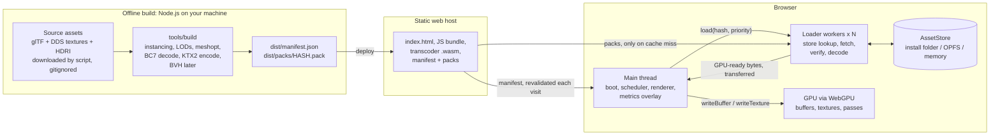
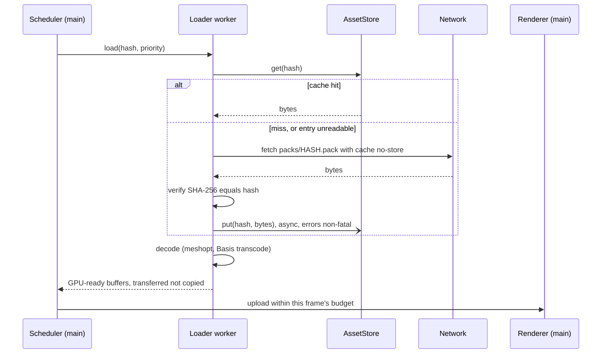
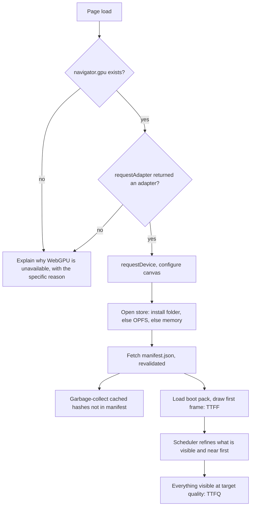

# Hyperion: original plan (archive)

> **Archived.** This is the original plan, approved on 2026-10-23. It is kept for its research, decisions, risks, milestones and sources. [`PLAN.md`](PLAN.md) is the current plan and takes priority wherever the two differ. Act numbers, milestone names, targets and status here are out of date.
>
> Personal details were removed before publishing, and "you" means the project's author. Browser and API facts were checked on 2026-10-23 and may have changed since (Appendix A).
>
> **How to read this:** §0 is the vision, §5A and §5B are the milestones, §10 holds the decisions. If a term is unfamiliar, §1 is a glossary.

## Contents

0. [The honest reframe, and the goal I propose](#0-the-honest-reframe-and-the-goal-i-propose)
1. [Glossary](#1-glossary)
2. [Architecture](#2-architecture)
3. [Stack options](#3-stack-options)
4. [Dependencies](#4-dependencies)
5. Milestones
   - 5A. [Act 0 (concept): current work](#5a-milestones-act-0-concept)
   - 5B. [Act 1 (loading)](#5b-milestones-act-1-loading)
6. [Act 2 outline: ray tracing](#6-act-2-outline-ray-tracing)
7. [Metrics: definitions, protocol, targets](#7-metrics-definitions-protocol-targets)
8. [Browser support and cross-origin isolation](#8-browser-support-and-cross-origin-isolation)
9. [Risks and unknowns](#9-risks-and-unknowns)
10. [Decisions I need from you](#10-decisions-i-need-from-you)
11. [How we'll work](#11-how-well-work)
- [Appendix A: Sources checked](#appendix-a-sources-checked)

---

## 0. The honest reframe, and the goal I propose

### What the reference games actually use, and what a browser can do today

You said the end goal is ray tracing on the web, "almost as good as Bodycam, and Forza with DLSS 5". I checked what those games use:

| Ingredient | What the games use | Can a browser do it today? |
|---|---|---|
| **Hardware ray tracing** (the RT cores on recent GPUs) | Forza Horizon 6: ray-traced reflections and ray-traced global illumination. Bodycam: Unreal Engine 5's Lumen. | **No.** WebGPU has no ray-tracing API. The first proposals (acceleration structures, and `rayQuery` in WGSL) were opened on **2026-10-13**, ten days ago. No browser implements them. |
| **Ray tracing in general** | n/a | **Yes, in software.** We write compute shaders that walk our own BVH. One native benchmark on the same GPUs measured software tracing at **4.5–6.5× slower per path-traced sample** than hardware ray queries, and 18–25× slower on a pure-traversal micro-benchmark. |
| **DLSS** | FH6 ships DLSS 4.5 (super resolution plus multi-frame generation). DLSS 5 is real (launched 2026-09-01) but is a different thing: a generative neural *re-rendering* model for RTX 50-series GPUs. I found no official Forza support, only a community-mod video. | **No.** DLSS is a native SDK (DirectX 11/12, Vulkan), licensed only for systems with NVIDIA GPUs. A web page can't call it. |
| **Upscaling in general** | DLSS / FSR / XeSS | **Yes.** We can write our own temporal upscaler in WGSL, modelled on AMD's FSR 2, which is MIT-licensed and documented. A *neural* upscaler in a browser is research territory: WebNN hasn't shipped, and the shader-level "subgroup matrix" feature is experimental and behind a Chrome flag. |
| **Photoreal assets** | Bodycam: Quixel Megascans plus real-world HDRI lighting | **Partly.** Licenses limit us to freely licensed scenes. Download size limits us to what streams in seconds. |
| **Bodycam's camera look** | Fisheye distortion, chromatic aberration, noise, a light-reactive black border, and a deliberately degraded image, per the developers | **Yes, and cheaply.** It's post-processing. |

**Two conclusions:**

1. "As good as Bodycam / Forza" isn't a measurable target. Taken literally, it isn't reachable in a browser this year. That's not a skill problem: the browser simply doesn't expose RT cores or DLSS.
2. The pieces that *are* reachable are rare on the web, and a few are genuinely unsolved there (listed below). That makes a stronger story than "almost as good as X": **"Here's what the web couldn't do, here's our implementation, and here are the numbers."**

### The goal I propose

> **Hyperion: loads like a web page, lit like a game.**
>
> Open a link and within about 3 seconds you're walking through Amazon Lumberyard Bistro, a large scene that's a standard ray-tracing test. It sharpens to full quality as you look around. On your next visit it's there in about a second. Wipe the browser's storage and it quietly recovers.
>
> Then flip a switch: shadows, reflections and bounce light are ray-traced in real time by our own WebGPU ray tracer. It runs on NVIDIA, AMD, Intel and Apple GPUs, and every claim is backed by numbers on screen.

The work falls into four acts. You chose to build the concept first:

- **Act 0: Concept** (§5A, the current work). A real-time path tracer with volumetrics and atmosphere. Its scenes are built from math-defined shapes, so no assets are needed yet. It does three jobs:
  - it's the "lit like a game" half of the pitch;
  - it shows the shader ambition up front;
  - it measures how many rays per second your GPU manages in a browser.
- **Act 1: Loading** (§5B). Your original brief: streaming, caching, recovery, metrics, and good-looking rendering of a real scene.
- **Act 2: Both at once** (§6; planned in detail later). The path tracer moves from math shapes to the streamed triangle scene. That brings BVHs, denoising, and our own temporal upscaler.
- **Act 3: Frontier.** Research, no promises: hardware `rayQuery` if browsers ship it, building BVHs on the GPU, and neural upscaling.

### Barriers worth breaking

From the research (Appendix A), I couldn't find these done in any WebGPU project:

1. **Streaming a large, unique scene together with its ray-tracing acceleration structures.** Existing WebGPU path tracers load a small scene all at once. Existing "Nanite-style" WebGPU projects don't stream over the network.
2. **A GPU BVH builder written in WGSL**, for example a port of PLOC or H-PLOC. Every web ray tracer I found builds its BVH on the CPU.
3. **Ray tracing, denoising and temporal upscaling together on a big streamed scene, in a browser, at interactive frame rates.** The pieces exist separately (RestirPT-WebGPU, Web-RTRT), but not on a scene this size with streaming.
4. **A temporal neural upscaler on WebGPU**, meaning a DLSS-like model that uses motion vectors. This is Act 3 research.

Act 1 is not a detour from these. Act 2 needs exactly what Act 1 builds:

- streamed geometry and compressed textures;
- an offline pipeline, which is where BVHs will be built;
- a renderer with a G-buffer and motion vectors (built in M14).

### What I'd change from your original brief

1. **Loading becomes Act 1 of a two-act demo.** Act 1 is designed so that Act 2 plugs in (§2.7).
2. **"As good as Bodycam / Forza" becomes measurable targets** (§7).
3. **Measure ray throughput early.** In v1 this was an optional spike (S1) after M5. In v2, Act 0's path tracer measures it from C1 onward, on math shapes. A triangle-BVH version of the measurement comes in Act 2.
4. **Visual ambition comes from real shading, not camera filters.** v1 proposed a Bodycam-style camera-look milestone. You wanted "crazy shaders" instead, so v2 has Act 0: path tracing, a physical sky, fog with light shafts, and volumetric clouds.
5. **Cross-vendor becomes a requirement** (your answer). No vendor-specific feature without a fallback, and we test on at least one non-NVIDIA GPU.
6. **New milestone M8, a BC7 decoder.** Bistro's textures exist only as BC7-compressed `.dds` files, and the KTX encoder only accepts PNG, EXR or raw input. I checked both.
7. **Asset packs bypass the browser's HTTP cache** (`cache: 'no-store'`). OPFS is then the only cache, so the numbers are honest.
8. **We keep instancing.** Bistro has 1.75M unique triangles but 4.2M once every placed copy is expanded (2.4×), so downloading each mesh once saves bytes.

---

## 1. Glossary

Read this once; refer back as needed. These are the terms someone is most likely to ask you about.

**GPU basics**

- **WebGPU.** The browser's API for the graphics card, and the successor to WebGL. Browsers implement it on top of Direct3D 12 (Windows), Metal (Apple) or Vulkan (Linux, Android).
- **Adapter / device.** An *adapter* is a physical GPU the browser offers you. A *device* is your app's private connection to it; every GPU object belongs to a device.
- **Shader / WGSL.** A *shader* is a small program that runs on the GPU, thousands of copies in parallel. *WGSL* is WebGPU's shader language.
- **Pipeline.** A compiled shader plus its fixed settings. A *render* pipeline draws triangles; a *compute* pipeline does general computation.
- **Buffer / texture.** GPU memory. Buffers hold arbitrary data (vertices, indices, parameters). Textures hold images that the GPU can filter and sample.
- **Bind group.** The set of buffers and textures handed to a shader for one draw.
- **Vertex / index / instance.** A *vertex* is a triangle corner (position, normal, texture coordinate). *Indices* say which vertices form each triangle. An *instance* is one placement of a mesh in the world: the same mesh plus a different transform.
- **Draw call.** One command telling the GPU "draw this mesh with this material".
- **Secure context.** HTTPS or `localhost`. WebGPU and OPFS only work in one.

**Detail, compression and assets**

- **LOD (level of detail).** Simplified versions of a mesh or texture, used when it's far away or small on screen.
- **Screen-space error.** Roughly how many pixels wrong a given LOD would look from the current camera. It drives which LOD to load and draw.
- **Mipmaps.** Pre-shrunk copies of a texture (½, ¼, …), used for distant surfaces.
- **Block compression (BC7, ASTC, ETC2).** Texture formats the GPU decodes in hardware, in 4×4-pixel blocks. Desktop GPUs use BC; Apple and mobile GPUs use ASTC and ETC2.
- **Basis Universal / KTX2.** *Basis* is a compact intermediate texture format that gets *transcoded* at load time into whatever block format the user's GPU supports. *KTX2* is its container file. Basis has two main modes: *UASTC* (higher quality, bigger) and *ETC1S* (smaller, lower quality).
- **meshoptimizer.** A library for compressing and simplifying meshes.
- **glTF.** The standard file format for 3D scenes, often called "the JPEG of 3D".

**Our data and caching**

- **Content hash.** A fingerprint (SHA-256) of a file's bytes. We name files by it, so a changed file automatically gets a new name.
- **Pack / manifest.** A *pack* is one of our binary files holding one or more resources. The *manifest* is a small JSON file listing every pack with its hash and size, and what's inside.
- **Web Worker.** A background JavaScript thread, so heavy work doesn't freeze the page.
- **Transferable.** Handing a block of memory (an `ArrayBuffer`) to another thread without copying it.
- **OPFS (Origin Private File System).** A private, fast file system inside the browser, one per website.
- **File System Access API.** Lets a page read and write a real folder the user picks. Chrome and Edge only.
- **Quota / eviction / persistence.** How much a site may store; the browser deleting a site's data when space runs short; asking the browser not to.
- **COOP/COEP (cross-origin isolation).** HTTP headers that unlock a few powerful features, such as `SharedArrayBuffer`. We plan to *not* need them (§8.2).

**Rendering techniques and our metrics**

- **BVH (bounding volume hierarchy).** A tree of boxes around triangles that makes ray tracing fast; APIs call it an "acceleration structure". *BLAS* is a tree per mesh; *TLAS* is a tree over the placed instances.
- **G-buffer.** Per-pixel surface information (depth, normal, material) written by the raster pass and read by the lighting and ray-tracing passes.
- **Motion vectors.** How far each pixel moved on screen since the last frame. TAA, denoising and upscaling all need them.
- **TAA (temporal anti-aliasing).** Smooths edges by blending each frame with re-projected previous frames.
- **Denoiser.** A filter that turns the noisy image from a few rays per pixel into a clean one. *SVGF* is a well-known example.
- **TTFF / TTFQ.** Time to first frame and time to full quality. Precise definitions are in §7.

**Path tracing and volumetrics (Act 0)**

- **Ray tracing (Whitted-style).** Follow one ray per pixel into the scene. At each hit, send extra rays toward the light (shadows) and along mirror directions (reflections). Sharp and fast, but no soft shadows or bounce light. Turner Whitted, 1980.
- **Path tracing.** Follow *random* light paths that bounce around the scene, and average many of them per pixel. This gives soft shadows, color bleeding, glass caustics and true global illumination. James Kajiya, 1986. It's what film renderers do.
- **Monte Carlo / samples per pixel.** Estimating an average from random samples. Few samples look noisy; more samples converge to the right answer. Noise falls with the square root of the sample count, so 4× the samples gives half the noise.
- **Progressive accumulation.** While the camera holds still, keep adding new samples into a running average, so the image sharpens over time. Moving the camera resets it.
- **Participating media.** Anything light scatters *inside*: fog, smoke, clouds, air itself.
  - **Extinction:** how quickly light is lost along a path.
  - **Scattering:** light bouncing off particles.
  - **Transmittance:** the fraction that survives a path (Beer–Lambert law).
  - **Phase function:** the angles in which light scatters.
- **Rayleigh / Mie scattering.** Scattering by air molecules (strongly favors blue, hence blue skies and red sunsets) and by larger particles like haze and droplets (white glow around the sun).
- **Delta tracking.** An unbiased way to sample random steps through media whose density varies, like clouds.
- **Mrays/s.** Millions of rays per second: the throughput number we report for the path tracer.

---

## 2. Architecture

### 2.1 The big picture



There are two programs, plus code they share:

- **The offline pipeline** (`tools/`) is Node.js on your machine. It turns source assets into packs and a manifest. All slow work happens here, once: simplification, compression, and later BVH building.
- **The runtime** (`src/`) runs in the browser. It loads the manifest, decides what to load next, loads it (cache first, then network), decodes it off the main thread, uploads it to the GPU, renders, and measures.
- **Shared code** (`shared/`) holds the binary pack format and the manifest types. Both programs use it, so the writer and the reader can never disagree about the format.

### 2.2 Modules and responsibilities

This is the target layout. A file only appears when a milestone needs it.

| Module | Responsibility | Unit-tested? | First appears |
|---|---|---|---|
| `src/platform/detect.ts` | Detect WebGPU, OPFS and File System Access. Produce a capability report, or a *specific* reason why we can't run. | Yes: the decision logic is a pure function | M0 |
| `src/platform/unsupported.ts` | Show that reason and what the user can do about it. | Manual | M0 |
| `src/gpu/device.ts` | Get the adapter and device, read limits and features, recover from device loss. | Manual | M0 |
| `src/math/` | Vectors, 4×4 matrices, frustum. | Yes | M1 |
| `src/render/` | Passes, pipelines, WGSL shaders, camera, GPU buffer and texture pools, materials. | Manual | M1 |
| `src/metrics/` | Timestamps, counters, percentiles, GPU timer, overlay. | Counters and percentiles: yes | M2 |
| `src/scene/` | Manifest loading, instances, culling, LOD selection. | Yes | M5, M11 |
| `src/stream/loader.ts` | Hand jobs between the main thread and the workers. | Partly | M6 |
| `src/workers/loader-worker.ts` | One job = turn a hash into GPU-ready bytes: store lookup, fetch, verify, store, decode. | Partly | M6 |
| `src/storage/` | The `AssetStore` interface and its folder, OPFS and memory implementations, plus cache policy (garbage collection, quota). | Policy: yes, using the memory store | M7, M12 |
| `src/stream/scheduler.ts` | Priority queue, budgets, cancellation. | Yes | M11 |
| `tools/fetch-assets.ts` | Download sources, verify checksums, record licenses. | Partly | M3 |
| `tools/build/` | glTF reading, instancing, LODs, meshopt encoding, BC7 decoding, KTX2 encoding, packing, manifest. | Mostly | M4 |
| `shared/pack-format.ts`, `shared/manifest.ts` | The binary format and manifest types, used by both sides. | Yes | M4 |

### 2.3 How one resource gets from request to pixels



The design choices behind this diagram:

- **Packs are content-addressed: each file is named by the SHA-256 of its bytes.** That has three consequences:
  1. Cache invalidation is automatic. A changed asset gets a new name, so a stale cache can never serve wrong data.
  2. After loading a new manifest, any cached hash that isn't in it is garbage and can be deleted.
  3. A host may cache packs forever, because a given name never changes content.
- **Workers do the whole "hash → GPU-ready bytes" job.** Disk reads, network fetches, hash checks and decoding all stay off the main thread. The bytes cross between threads once, as transferables.
- **The main thread owns the GPU.** Uploads are budgeted per frame, so streaming can't cause a visible hitch.
- **The cache never affects correctness.** Any storage error is treated as a cache miss and leads to a re-download. Writes are fire-and-forget.
- **The manifest is small and always revalidated** (`cache: 'no-cache'`, i.e. "ask the server whether it changed").

### 2.4 Boot sequence, and the storage scenarios



| Scenario | What happens | Cost |
|---|---|---|
| **First visit** | The store is empty, so the boot pack and visible content come from the network. They're written to the store in the background. | Network-bound |
| **Repeat visit** | The manifest is revalidated (one round-trip, usually "not modified"), and every pack comes from the store. | Disk-bound; target about 1 s |
| **Storage cleared** | Cleared by the user, by Safari's 7-day rule (§8.1), or by eviction. Entries are missing, or vanish mid-session. Each one is just a miss and gets re-downloaded, and the overlay shows "cache cold". | Same as a first visit, with no errors |
| **Store unavailable** | For example, Firefox private windows have no OPFS. We fall back to a memory store, and the overlay says "no persistent cache". | Every visit costs the same as a first visit |
| **Quota exceeded** | We evict once and retry once. If that fails, we stop writing and keep streaming from the network. | First-visit cost for whatever didn't fit |

### 2.5 Pack format and manifest: first sketch

The exact layout is decided in M4. The idea:

```text
pack file = header { magic "HYPK", version, entry count }
          + entry table [ { kind, offset, length } ... ]
          + payloads, each 16-byte aligned
```

```jsonc
// manifest.json (sketch)
{
  "format": 1,
  "boot": "a17c…",                                   // pack needed for the first frame
  "packs": { "3f9a…": { "bytes": 183422 } },          // hash → size, for verification and stats
  "meshes": [{ "bounds": [/* min, max */],
               "lods": [{ "pack": "3f9a…", "entry": 0, "triangles": 12000, "error": 0.004 }] }],
  "instances": [{ "mesh": 0, "material": 3, "transform": [/* 16 numbers */] }],
  "materials": [ /* factors + texture references */ ],
  "textures": [{ "tiers": [{ "pack": "…", "entry": 2, "width": 256 }] }]
}
```

The storage interface is the one abstraction we create up front. It's justified because it has three implementations (folder, OPFS, and memory for tests and fallback):

```ts
interface AssetStore {
  get(hash: string): Promise<ArrayBuffer | null>; // null = miss; "not there" never throws
  put(hash: string, bytes: ArrayBuffer): Promise<'stored' | 'quota-exceeded' | 'failed'>;
  delete(hash: string): Promise<void>;
  keys(): Promise<string[]>;
}
```

### 2.6 Where a WebGL2 fallback would fit (not built)

A WebGL2 fallback would be a second renderer next to `src/render/`, consuming the same `scene/`, `stream/` and `storage/` modules.

- **What carries over:** the asset formats. Basis can transcode to WebGL's compressed formats too.
- **What wouldn't:** anything that needs compute shaders, such as GPU culling and all of Act 2.

To keep the door open cheaply, the rule is that **nothing outside `src/gpu/` and `src/render/` may touch the WebGPU API**. For example, the scheduler only knows about bytes and priorities, never GPU objects.

### 2.7 Where Act 2 plugs in

- **Pipeline.** `tools/build` gains a BVH builder, so each mesh LOD's pack also carries its BVH (a BLAS).
- **Runtime BVH.** The runtime rebuilds a small top-level tree (TLAS) over the resident instances whenever residency changes.
- **Renderer inputs.** M14's G-buffer and motion vectors are exactly what ray-traced passes, the denoiser and the upscaler need.
- **Scheduler.** Its priority function gains a term for geometry that is *off-screen but visible in reflections*. That's an open research question for streaming plus ray tracing.

---

## 3. Stack options

These are your decisions. My recommendations and the reasons are below; all decisions are collected in §10.

### D1: Rendering approach

| | **A. Raw WebGPU** *(recommended)* | B. three.js `WebGPURenderer` | C. Babylon.js | D. Rust + wgpu → Wasm |
|---|---|---|---|---|
| Code you can read end to end | **Yes.** Every line is ours. | No. It's a large engine, and you'd be learning its abstractions. | No. An even larger engine. | Our code, yes. wgpu and the binding glue, no. |
| Runtime dependencies | 2 (mesh decoder, texture transcoder) | three.js plus loaders | Babylon packages | wgpu, web-sys, wasm-bindgen, … |
| Time to a good-looking result | Slowest | Fastest: PBR, KTX2 and meshopt are built in | Fast | Slow: toolchain and bindings |
| Control over streaming and GPU memory | Full | Partial; you fight the engine's model | Partial | Full |
| Path to ray tracing (Act 2) | Direct: our own compute passes | You must step outside the engine. Its custom-shader path (`ShaderMaterial`) isn't supported by `WebGPURenderer`; you'd use its node system, TSL, instead. | You must step outside the engine | Direct. But wgpu's ray-query support is native-only and doesn't exist in browsers either. |
| WebGL2 fallback | We'd write it (not planned) | Automatic | Automatic | wgpu has a GL backend |
| Someone asks "how does this work?" | You wrote it, so you can answer | "three.js does that" | Same | You wrote it, but through more layers |
| Startup cost (affects TTFF) | Smallest JavaScript | Larger bundle | Larger bundle | Wasm binary download and compile |
| Maturity notes | WebGPU is shipping in all four browsers, with OS caveats (§8) | The three.js manual still calls `WebGPURenderer` "experimental" | Mature | Multi-threaded Wasm needs `SharedArrayBuffer`, which needs COOP/COEP (§8.2) |

**Recommendation: A, raw WebGPU.** Your goals all point the same way: understand every part, break barriers, keep dependencies minimal. The cost is that the first good-looking frame arrives at M9 and M13, not on day one as it would with three.js.

We will still *read* other implementations as references, without depending on them. For example, three.js's KTX2Loader shows how to pick a transcode target.

**Decided: A.** In the v2 questions I also offered C++ compiled to Wasm (via Dawn's `emdawnwebgpu` port of `webgpu.h` for Emscripten), and you picked TypeScript. C++ can still come in later, through Wasm, for heavy CPU work such as BVH building, but only through a plan update.

### D2: Language

**TypeScript in strict mode** *(recommended)*.

- **In the browser:** compiled by the build tool (D3).
- **In tools and tests:** Node 24 runs `.ts` files directly through "type stripping", so there's no build step for scripts. Type stripping has been stable since Node 24.12.
- **The constraint:** only *erasable* TypeScript works. That means no `enum`, no `namespace`, no constructor parameter properties, and explicit `.ts` extensions in imports. We'd turn on `erasableSyntaxOnly` so the compiler enforces this everywhere. I'd want this anyway: what you read is what runs.
- **Alternative:** plain JavaScript with JSDoc type comments. No compile step at all, but the types are clunkier to write.

### D3: Build tool (browser side)

| **Vite** *(recommended)* | esbuild + a ~40-line script of ours | No bundler (`tsc` + ES modules + import map) |
|---|---|---|
| A standard dev server with instant reload. It bundles workers and `.wasm` files by convention. It's dev-only: nothing from Vite ships to users. The downside is a large tree of *dev* dependencies. | One binary with zero dependencies. We write the dev-server and rebuild script ourselves, so you can read the build too. | The most transparent option. But it means many module requests at load, which is bad for TTFF, and no minification. |

### D4: Test runner

**`node:test`** *(recommended)*. It's built into Node, so there's no dependency, and it runs `.ts` files directly. Tests cover the pure logic.

For browser-only behavior (real OPFS, the GPU), I'll write manual check steps. Where useful I'll also add in-page self-tests, for example `?selftest=storage`, which exercises the real OPFS store.

The alternative is Vitest: nicer output, one more dependency tree.

### D5: Math

**Our own small module** *(recommended)*: vectors, 4×4 matrices and frustum planes, about 200 lines, unit-tested.

Matrix conventions are exactly what people ask about: column-major layout, WebGPU's depth range of 0 to 1 (WebGL's is −1 to 1), and reverse-Z. Writing them ourselves means you can explain them.

The alternative is `wgpu-matrix` (MIT).

### D6: Reading glTF in the pipeline

**Our own minimal glTF reader, plus meshoptimizer** *(recommended)*. Three reasons:

1. **We don't output glTF.** We write our own packs, so glTF-Transform's main strengths (transforms and glTF writing) go unused.
2. **Bistro has quirks a general library won't handle.** Its textures are referenced through `MSFT_texture_dds`, which glTF-Transform doesn't support. And its PNG references point to files that don't exist.
3. **The reader is small.** glTF is JSON plus one binary file. Reading just the features our assets use is about 300 lines, and it fails loudly on anything else.

The alternative is glTF-Transform 4.5.1 (MIT), plus custom handling for the DDS references.

### D7: Scene

| | **Amazon Lumberyard Bistro** *(recommended)* | Intel Sponza | Assembled from Poly Haven |
|---|---|---|---|
| License | CC BY 4.0 via NVIDIA ORCA: attribution required, derivatives allowed | "Creative Commons Attribution", version not stated on the page; must be checked inside the zip | CC0, no attribution needed |
| Format | glTF copy at `zeux/niagara_bistro`, which I inspected | glTF | glTF per prop |
| Size | 2.32 GB source, 396 files | 3.99 GB zip (base scene) | Small per asset |
| Content | 1.75M unique triangles; 2,909 instances; 254 materials; 343 textures (51 at 4096²); 1 sun + 96 point lights; exterior and interior | One very detailed courtyard | Props, not a scene; we'd compose one |
| Why or why not | Large, and a **standard ray-tracing test scene**, so Act 2 comparisons mean something. The catch: BC7-only textures (M8) and spec/gloss materials. | Gorgeous, but a big download and a single space. | Fully free, but "large scene" would be our own level design. |

**Also used:**

- **FlightHelmet** (CC0, Khronos samples): a small asset for early tests.
- **One Poly Haven HDRI** (CC0): sky and image-based lighting.

**Avoid:**

- **Crytek Sponza.** Its CRYENGINE license limits distribution.
- **Emerald Square and Sun Temple.** Non-commercial licenses.
- **DamagedHelmet.** Its original was non-commercial.

**Note:** the Bistro glTF repo's own `LICENSE` file says MIT (inherited from NVIDIA's RTXDI-Assets), but the content is ORCA's CC BY 4.0 Bistro. We'll honor CC BY 4.0, the stricter of the two, and double-check in M3.

---

## 4. Dependencies

Versions and licenses were checked on npm and the projects' release pages on 2026-10-23. Every dependency needs a reason; if it can be done with a built-in API, it is.

### Runtime (shipped to the browser)

| Dependency | Version | License | Why we need it | Size |
|---|---|---|---|---|
| `meshoptimizer` (the decoder module only) | 1.3.0 | MIT | Decodes meshopt-compressed vertex and index data inside our workers. It's Wasm with SIMD, and fast. | ~28 KB |
| Basis Universal transcoder (`basis_transcoder.js` + `.wasm`) | built from basis_universal v2.50 (or a pinned prebuilt) | Apache-2.0 | Transcodes KTX2/Basis textures to BC7, ASTC, ETC2 or RGBA8 for the user's GPU. It isn't on npm in a usable form, so it's vendored or fetched (D9). | ~527 KB Wasm + ~57 KB JS (three.js's build) |

That's the entire runtime list: no framework, no math library, no IndexedDB wrapper.

### Development only

| Dependency | Version | License | Why |
|---|---|---|---|
| `typescript` | 7.0.2 (latest; 6.0.3 as fallback) | Apache-2.0 | Type checking only (`tsc --noEmit`). |
| `@types/web` | 0.0.359 | Apache-2.0 | Complete WebGPU type definitions. **Every released TypeScript (6.0.3, 7.0.2) ships only a partial set**, per the `@webgpu/types` README, which recommends this package. |
| `@types/node` | 24.x (matching your Node) | MIT | Types for Node APIs in `tools/`. Browser code and tool code get separate tsconfigs, so browser code can't accidentally use Node APIs and vice versa. |
| `vite` | 8.3.5 | MIT | Dev server and bundler, if D3 = Vite. (`esbuild` 0.28.2, MIT, if D3 = esbuild.) |

### Offline pipeline (dev only)

| Dependency | Version | License | Why |
|---|---|---|---|
| `meshoptimizer` (encoder, simplifier, clusterizer) | 1.3.0 | MIT | LOD generation (`simplifyWithAttributes`) and compression (vertex and index encoding). Later, meshlets for Act 2. |
| KTX-Software `ktx` command-line tool | **4.4.2, pinned** | Apache-2.0 | Encodes textures to KTX2 (UASTC or ETC1S). It's installed with its Windows installer, not npm. Pinned because 5.0, currently a release candidate, renames options and changes defaults. |
| *(only if needed)* `fflate` | 0.8.3 | MIT | Unzipping. Bistro and FlightHelmet are plain files on GitHub, so probably unnecessary. Windows' built-in `tar.exe` can also extract zips. |

**Built-in instead of a dependency:**

| Need | Built-in we use |
|---|---|
| SHA-256 | `node:crypto` in tools; `crypto.subtle` in the browser |
| Downloads | `fetch` (in both Node and the browser) |
| Tests | `node:test` |
| Storing the install folder's handle | the raw IndexedDB API (~40 lines) |
| BC7 decoding | our own code (M8) |

**Deliberately not added:** three.js, gl-matrix / wgpu-matrix, idb, a zstd decoder, sharp, glTF-Transform (unless you pick D6-B).

---

## 5A. Milestones: Act 0 (concept)

This is the current work, and it comes before Act 1.

- **No assets.** Act 0's scenes are built from math-defined shapes (spheres, boxes, planes), so the page loads instantly. The loading problem waits for Act 1.
- **Same descriptions.** Each milestone uses the same layout as in §5B, and §5B's browser-tool tips apply here too.

**What carries forward:**

- C0's scaffolding becomes Act 1's M0.
- C1's path tracer and metrics become the core of Act 2.
- C2–C3's sky and fog are reused for the real scene in M15.

### C0: Skeleton and first ray-traced pixels

- **Goal:** a webpage that ray-traces a small scene live, or explains *exactly* why it can't.
- **Adds:**
  - **Scaffolding:** `package.json` scripts (`dev`, `build`, `preview`, `typecheck`, `test`), browser and test tsconfigs, `.gitignore`, `index.html`, a README.
  - `src/platform/detect.ts` + `unsupported.ts`: a specific reason for each failure (insecure context, no WebGPU, no adapter, device request failed), with `?simulate=` to preview each.
  - `src/gpu/device.ts`: adapter and device, logging of uncaught GPU errors, recovery from device loss.
  - `src/gpu/canvas.ts`: the canvas sized to exact device pixels.
  - `src/math/vec3.ts` and `src/camera/orbit.ts`: an orbit camera (drag to rotate, wheel to zoom).
  - `src/render/whitted.wgsl` + `whitted-pass.ts`:
    - one ray per pixel from a full-screen triangle;
    - spheres and a ground plane;
    - a moving sun with ray-traced hard shadows;
    - mirror reflections.
  - A small HUD: GPU, resolution, frame interval.
- **Unit tests:** the diagnosis logic; the device-loss restart rule; `vec3`; the orbit camera's basis; the uniform-buffer layout.
- **Acceptance:**
  - Chrome/Edge show the scene, and you can orbit and zoom.
  - Shadows follow the sun; reflections are correct.
  - Each `?simulate=` value shows its message.
  - Opening `chrome://gpucrash` in another tab loses the device, and the page recovers.
  - `npm run typecheck`, `npm test` and `npm run build` pass, with no console errors.
- **You'll be able to explain:**
  - the path from JavaScript to pixels;
  - why a single full-screen triangle;
  - ray–sphere and ray–plane intersection;
  - shadow rays;
  - WGSL's uniform-buffer alignment rules;
  - why this is "Whitted-style" ray tracing, and what it can't do (soft shadows, bounce light). That gap is C1.
- **Size:** ~700 lines, including ~150 of WGSL and ~150 of tests.

### C1: Path tracer

- **Goal:** real global illumination: soft shadows, color bleeding, glass, glowing materials and depth of field, sharpening while the camera holds still.
- **Adds:**
  - A compute-shader path tracer:
    - random numbers on the GPU (a hash-based generator);
    - materials: diffuse, rough metal, glass with Fresnel, emissive;
    - Russian roulette path termination.
  - The scene described in TypeScript and uploaded as a storage buffer.
  - Progressive accumulation in a floating-point storage texture, reset when the camera or scene changes.
  - A display pass with tone mapping and sRGB encoding.
  - Anti-aliasing for free: random sub-pixel positions.
  - Metrics: frame time p50/p95/p99, samples per pixel, **Mrays/s**, and GPU time via `timestamp-query` when available.
- **Unit tests:** scene packing (TypeScript objects to the GPU buffer layout); percentile math; the accumulation-reset rules.
- **Acceptance:**
  - A still camera converges to an image that looks like an offline render.
  - Mrays/s is reported at 1080p on the test GPU.
  - Noise visibly drops as samples accumulate.
  - No validation errors.
- **You'll be able to explain:**
  - the rendering equation, intuitively;
  - Monte Carlo integration and importance sampling;
  - why noise appears, and why accumulation removes it;
  - Fresnel;
  - compute vs fragment shaders;
  - storage textures.
- **Size:** ~700 lines. May split into 1a (core and diffuse) and 1b (materials and metrics).

### C2: Sky and fog

- **Goal:** atmosphere. A physically based sky that changes with the sun's angle, and light shafts through fog.
- **Adds:**
  - A sky model with Rayleigh and Mie scattering, with its transmittance table precomputed in a compute pass. This follows Hillaire's 2020 approach, simplified.
  - Sun-angle control.
  - A uniform fog medium inside the path tracer:
    - free-flight distance sampling;
    - the Henyey–Greenstein phase function;
    - light shafts that appear naturally where shadows cross the fog.
- **Unit tests:** the phase function integrates to 1 (numerically); the distance sampling has the right mean free path; the lookup-table parameterization round-trips.
- **Acceptance:** a sunrise → noon → sunset sweep looks plausible, fog shows shafts through gaps, and the cost is reported.
- **You'll be able to explain:** extinction, scattering and transmittance (Beer–Lambert); phase functions; why the sky is blue and sunsets are red.
- **Size:** ~600 lines.

### C3: Volumetric clouds

- **Goal:** clouds you can fly into.
- **Adds:**
  - Varying-density media: procedural 3D noise baked into a 3D texture by a compute pass.
  - Delta tracking (unbiased sampling through varying density).
  - Clouds lit by sun and sky with real scattering bounces.
  - A fly camera (WASD) alongside the orbit camera.
- **Unit tests:** noise determinism and range; the majorant/delta-tracking step logic.
- **Acceptance:** sunlit clouds with bright silver linings at the edges; flying through them works; frame time reported.
- **You'll be able to explain:** heterogeneous media, majorants, delta tracking, 3D textures.
- **Size:** ~600 lines.

### C4: Showcase page

- **Goal:** a page you'd send to someone.
- **Adds:**
  - a hand-written control panel (sun angle, fog density, cloud coverage, bounce count, resolution scale), with no UI library;
  - preset scenes;
  - a screenshot button;
  - an "about" panel explaining what the viewer is seeing;
  - deployment (D8), done only when you say to push.
- **Acceptance:** works on a cold visit to the deployed URL, and on another computer if one is available.
- **Size:** ~400 lines.

**After Act 0, Act 1 resumes at M1.**

---

## 5B. Milestones: Act 1 (loading)

**How each milestone is described:**

- **Goal:** what it achieves.
- **Adds:** the code it introduces.
- **Unit tests:** for the pure logic.
- **Acceptance:** when it counts as done.
- **Check it yourself:** steps you can do in the browser.
- **You'll be able to explain:** concepts you'll own by the end.
- **Size:** a rough count of new lines.

Anything over ~500 lines may be split when we get there, so each stays reviewable in one sitting.

**Browser tools you'll use:**

- Press **F12** to open DevTools. *Console* shows errors (WebGPU validation errors appear there). *Network* shows downloads. *Performance* records what each thread did. *Application → Storage* shows OPFS usage and has "Clear site data".
- `chrome://gpu` shows what Chrome thinks of your GPU.

### M0: Skeleton, and "can this browser run it?"

> **Built as part of C0.** Kept here for reference.

- **Goal:** a page that either clears the screen through WebGPU or explains *exactly* why it can't.
- **Adds:**
  - project scaffolding: `package.json` scripts (`dev`, `build`, `typecheck`, `test`), tsconfigs (strict, `erasableSyntaxOnly`), build-tool config, `.gitignore`, `index.html`, `src/main.ts`, README stub;
  - `src/platform/detect.ts` and `unsupported.ts`;
  - `src/gpu/device.ts` (adapter and device, plus a device-lost handler that rebuilds the renderer).
- **Unit tests:** the detect verdict function, fed fake inputs: no `navigator.gpu`, null adapter, insecure context, OK.
- **Acceptance:**
  - Chrome and Edge show a cleared canvas, plus one line of adapter info (vendor, architecture) and its features.
  - `?simulate=no-webgpu`, `?simulate=no-adapter` and `?simulate=insecure` each show the matching message.
  - `npm run typecheck` and `npm test` pass.
- **Check it yourself:**
  1. Run `npm run dev` and open the printed URL in Chrome.
  2. Try each `?simulate=` value.
  3. Try Firefox, which has WebGPU on Windows since version 141.
  4. Compare the adapter line with `chrome://gpu`.
- **You'll be able to explain:** secure contexts; the chain from `navigator.gpu` to adapter to device; why `requestAdapter()` can return null; what device loss is and how we recover.
- **Size:** ~250 lines.

### M1: First 3D, a lit cube you can fly around

- **Goal:** understand the whole path from vertex data to pixels.
- **Adds:**
  - `src/math/`: vec3; mat4 with perspective (reverse-Z, WebGPU's 0..1 depth range), `lookAt` and inverse;
  - a minimal `src/render/`: vertex buffer, WGSL shader, pipeline, depth texture, uniform buffer, bind group;
  - fly camera (WASD plus mouse, using pointer lock);
  - resize handling, including high-DPI screens (`devicePixelRatio`).
- **Unit tests:** known matrices; inverse × matrix = identity; with reverse-Z, the projection maps the near plane to depth 1 and the far plane to depth 0.
- **Acceptance:** a rotating lit cube; fly camera works; depth ordering is correct; no validation errors at any window size.
- **Check it yourself:** resize the window. Break a shader on purpose to see what WebGPU's error messages look like (I'll show you how).
- **You'll be able to explain:** the vertex → clip space → screen pipeline; why WebGPU's depth range differs from WebGL's; why reverse-Z gives far better depth precision in big scenes; what a bind group is.
- **Size:** ~400 lines.

### M2: Metrics overlay v1

> **Partly built in C1** (percentiles, GPU timer). M2 adds TTFF, byte counters and the JSON export.

- **Goal:** build the measuring instrument before there's anything big to measure.
- **Adds:** `src/metrics/`:
  - navigation-relative marks and counters;
  - a ring buffer with p50/p95/p99 percentiles;
  - a GPU timer using `timestamp-query` when available ("n/a" otherwise);
  - the overlay, updated a few times per second so it doesn't cost frame time;
  - a "copy as JSON" button.
- **Unit tests:** percentile math, the ring buffer, counter aggregation.
- **Acceptance:** the overlay shows the cube's TTFF, CPU frame time (p50/p95/p99) and GPU time in Chrome. The JSON export works.
- **Check it yourself:**
  1. Compare overlay numbers against a DevTools Performance recording.
  2. Enable `chrome://flags` → "WebGPU Developer Features" and watch GPU timings get finer. Chrome rounds them to 100 µs by default.
- **You'll be able to explain:** why percentiles beat averages; what "first frame" means precisely (§7); why GPU time differs from CPU time; why browsers deliberately coarsen timers (to block timing attacks).
- **Size:** ~300 lines.

### M3: Fetch the sample assets, with licenses

- **Goal:** reproducible source assets without committing any binaries.
- **Adds:**
  - `tools/assets.json`, listing each source file: URL, expected SHA-256, size, license, attribution;
  - `tools/fetch-assets.ts`, which downloads into `assets-src/` (gitignored), verifies hashes, skips files already verified, and generates `ATTRIBUTION.md` (committed).
  - The assets: FlightHelmet (CC0), Bistro (CC BY 4.0, 2.3 GB) and one Poly Haven HDRI (CC0).
- **Unit tests:** validating the source list; the skip-if-hash-matches logic, using a temp folder.
- **Acceptance:** a fresh run downloads and verifies everything; a second run downloads nothing; a corrupted file gets re-downloaded; `git status` shows no binaries.
- **Check it yourself:** run it twice and compare times. Change one byte of a file and rerun. Read `ATTRIBUTION.md`.
- **You'll be able to explain:** how hashes pin exact asset versions; CC0 vs CC BY and what attribution we owe.
- **Size:** ~200 lines. **Needs ~2.5 GB of free disk.**

### M4: Pack format, manifest, pipeline v1 (geometry only)

- **Goal:** the whole offline half of the system, end to end, without compression yet.
- **Adds:**
  - `shared/pack-format.ts` (writer and reader);
  - `shared/manifest.ts` (types and a validator);
  - `tools/build/gltf-read.ts`: our minimal reader, which fails loudly on unsupported features;
  - `tools/build/index.ts`: meshes become per-mesh geometry entries, plus an instance list and material constants;
  - content hashing, with output to `dist/` (gitignored).
- **Unit tests:**
  - pack round-trip: write, read back, identical;
  - manifest validator on one good and several bad manifests;
  - **determinism:** the same input always gives identical hashes;
  - the glTF reader on a tiny hand-written fixture.
- **Acceptance:** `npm run build:assets` produces a manifest and packs for FlightHelmet and Bistro, prints stats (meshes, instances, triangles, bytes), and a rebuild gives identical hashes.
- **Check it yourself:** read `manifest.json`. Build twice and compare. Open a pack in a hex viewer and find the `HYPK` magic bytes.
- **You'll be able to explain:** glTF's accessors and buffer views; why we ship our own format instead of glTF; content addressing.
- **Size:** ~600 lines. Can be split into reader / writer halves.

### M5: Draw Bistro from packs (the naive baseline)

- **Goal:** see the whole scene, and record the "before" numbers that everything later must beat.
- **Adds:**
  - manifest loading;
  - fetching *every* pack at startup (no streaming, no cache);
  - GPU upload;
  - drawing the instances in a forward pass with simple shading (one flat color per material);
  - fly-camera speed control;
  - byte counters in the overlay;
  - `docs/RESULTS.md`, where measured numbers live from now on.
- **Acceptance:** Bistro renders correctly from any angle, with no missing or garbled meshes. The overlay shows TTFF, total bytes and frame time. Cold-start numbers are recorded for localhost and for a throttled network.
- **Check it yourself:** walk around. In the Network panel, watch every pack download before anything appears. Then throttle the network to feel how bad naive loading is.
- **You'll be able to explain:** instancing; draw calls; why "load everything, then show anything" is slow.
- **Size:** ~400 lines.

### S1 (optional spike, after M5): Can your GPU ray-trace Bistro in a browser?

> **Superseded in v2.** C1 measures rays per second from Act 0 onward. The triangle-BVH version of this measurement moves to Act 2 (R1). Kept for reference.

- **Goal:** measure, early, the number that decides how ambitious Act 2 can be.
- **Adds:** a throwaway page, `spike/raycast.html`, that is not part of the app:
  - a CPU-built BVH (binned SAH, built in a worker);
  - a compute shader casting one camera ray and one shadow ray per pixel;
  - a millions-of-rays-per-second report at 720p and 1080p.
- **Acceptance:** the ray-traced image matches the raster view. Rays per second are measured on the test GPU in Chrome and Edge, and on a second GPU if one is available.
- **You'll be able to explain:** BVH traversal on a GPU; why it's slower without RT cores; how a rays-per-second budget translates into effects. For example, 1 ray per pixel at 1080p and 60 fps is 124 million rays per second.
- **Size:** ~500 lines, archived afterwards.
- **Watch out for:** WebGPU's default 128 MiB limit per storage-buffer binding. We'll request higher limits from the adapter, or split the data.

### M6: Workers and meshopt geometry compression

- **Goal:** smaller downloads, and a main thread that stays smooth while loading.
- **Adds:**
  - in the pipeline: meshopt encoding of vertex and index streams, plus quantizing positions, normals and texture coordinates to 16-bit;
  - at runtime: a worker pool with a small typed message protocol, the meshopt decoder in the workers, and transferables.
- **Unit tests:** message encoding and decoding with a fake worker; quantization round-trip error bounds.
- **Acceptance:** geometry bytes reduced (ratio reported); visually identical; no main-thread task over 50 ms during load; TTFF compared against M5 in `RESULTS.md`.
- **Check it yourself:** record a Performance trace while loading. Decode work should appear on the worker threads, not the main thread.
- **You'll be able to explain:** what meshopt compression exploits; transferring vs copying; quantization.
- **Size:** ~400 lines.

### M7: OPFS cache

- **Goal:** the second visit comes from disk, and any storage failure is just a miss.
- **Adds:** `src/storage/`:
  - the `AssetStore` interface;
  - `opfs-store.ts`, used inside the workers. It writes with `createWritable()`, which writes to a swap file and only replaces the real file on `close()`, so a crash mid-write never leaves a half-written entry.
  - `memory-store.ts` (tests and fallback);
  - `cache-policy.ts`: garbage collection of hashes not in the manifest, plus quota handling (on `QuotaExceededError`, evict once and retry once, else go read-only);
  - SHA-256 verification after download, and a size check on read;
  - a **"Keep offline copy" button** that calls `navigator.storage.persist()`. It's a button because Firefox shows a permission prompt.
  - the overlay shows `estimate()` and `persisted()`;
  - a "Clear cache & reload" button;
  - the `?selftest=storage` page.
- **Unit tests** (policy, using the memory store): hit/miss; garbage collection; quota exceeded → degrade; wrong-size entry → delete and miss; store throws → miss.
- **Acceptance:**
  - The second load has ~0 network bytes for packs, and every pack is a hit.
  - DevTools "Clear site data" in the middle of a session causes no crash, just re-downloads.
  - A simulated full disk shows the degraded message and keeps rendering.
  - A Firefox private window shows "no persistent cache" and still works.
- **Check it yourself:** watch Application → Storage usage. Clear site data while walking around. Run the self-test page.
- **You'll be able to explain:**
  - OPFS vs the HTTP cache vs IndexedDB;
  - each browser's quota, eviction and persistence rules;
  - why content addressing makes invalidation trivial;
  - how atomic writes work here.
- **Size:** ~500 lines.

### M8: BC7 decoder (pipeline)

- **Goal:** unlock Bistro's textures, which exist only as BC7 `.dds` files, and learn GPU texture compression from the bits up.
- **Adds:**
  - `tools/build/dds.ts`: parsing the DDS header and its DX10 extension;
  - `tools/build/bc7.ts`: all 8 BC7 block modes;
  - a debug page that shows our decode **next to the GPU's own hardware decode of the same file**. Desktop GPUs decode BC7 natively, so the GPU is our reference decoder.
- **Unit tests:** header parsing; hand-built blocks for each mode with known outputs; reference blocks captured from the hardware decode.
- **Acceptance:** for a sample of Bistro textures, our output matches the hardware decode pixel for pixel. Decode speed is reported.
- **Check it yourself:** open the debug page and use the amplified difference view.
- **You'll be able to explain:** how block compression works (4×4 blocks, endpoints, indices, partitions); why GPUs decode it in hardware; why we re-encode for the web (size).
- **Size:** ~500 lines.

### M9: KTX2/Basis textures and PBR materials

- **Goal:** Bistro looks like Bistro: textured, normal-mapped, physically based.
- **Adds:**
  - **Pipeline:**
    - decoded RGBA goes into `ktx create`, which produces KTX2 files (codec per texture type decided in D10);
    - material conversion: either convert spec/gloss to metal/rough, or render spec/gloss directly. That's decided after inspecting what Bistro's "spec" textures actually contain.
  - **Runtime:**
    - the Basis transcoder in the workers;
    - transcode target chosen from adapter features: BC7, then ASTC, then ETC2, then RGBA8;
    - mipmap upload;
    - a PBR shader (GGX) lit by the sun only;
    - alpha-tested foliage;
    - simple sorted blending for glass.
- **Unit tests:** transcode-target selection; material conversion math; texture entries in the manifest.
- **Acceptance:** Bistro is textured and normal-mapped. The overlay reports texture bytes and transcode time. `?texfmt=rgba8` (forcing the uncompressed path) still works.
- **Check it yourself:** compare against reference screenshots of Bistro. Force each texture format.
- **You'll be able to explain:** supercompression vs GPU formats; why we transcode at load time; sRGB vs linear color; how normal maps are encoded; PBR basics (GGX, metal/rough).
- **Size:** ~600 lines. Likely split into 9a (textures) and 9b (materials).

### M10: Pipeline for streaming: LODs, texture tiers, boot pack

- **Goal:** produce the data that makes progressive loading possible.
- **Adds:**
  - a per-mesh LOD chain (about 4 levels, meshopt `simplifyWithAttributes`), each level recording its geometric error in world units;
  - texture tiers taken from the existing mip chain:
    - **tier 0** is tiny *uncompressed* RGBA8, so the first frame doesn't wait for the 0.5 MB transcoder;
    - **tier 1** is about 256 px;
    - **tier 2** is full size, capped per D11;
  - spatial cells for instances;
  - **the boot pack:** the coarsest LOD of everything plus tier-0 textures, targeting at most ~2–3 MB;
  - manifest v2.
- **Unit tests:** LOD error increases monotonically; tier selection; boot pack contents; the v2 validator; builds are still deterministic.
- **Acceptance:** build stats show bytes per LOD level and the boot pack size. A runtime debug view can force LOD *n* or tier *n* everywhere.
- **You'll be able to explain:** mesh simplification and error metrics; what the first frame actually needs, and why that fits in a boot pack.
- **Size:** ~500 lines.

### M11: Streaming scheduler, visible and near first

- **Goal:** a first frame in seconds, then refinement prioritized by what you're looking at.
- **Adds:**
  - frustum culling;
  - LOD choice by screen-space error;
  - `stream/scheduler.ts`:
    - priority order: visible first, then the most error reduced per byte;
    - budgets for concurrent requests, worker jobs, upload bytes per frame and GPU memory (with eviction of high LODs that are no longer needed);
    - cancellation when priorities drop;
  - TTFQ detection.
- **Unit tests:** priority ordering; budgets respected; cancellation; re-prioritizing after the camera moves; the TTFQ condition.
- **Acceptance:**
  - Cold load on a throttled network: the first frame comes from the boot pack, then visibly refines.
  - TTFF and TTFQ (cold and warm) are recorded and beat M5.
  - Turning around refines the newly visible things first.
  - p99 frame time stays under 2× the median while streaming.
- **Check it yourself:** use `?bench` (camera locked at the start pose) cold and warm. Watch the refinement on a throttled network. Press the "freeze LOD selection" debug key and fly around to inspect.
- **You'll be able to explain:** priority queues; screen-space error; why streaming is fundamentally a scheduling problem.
- **Size:** ~600 lines.

**After M11, the loading demo exists. After M12, every pillar of your original brief is covered.**

### M12: Install to folder (File System Access)

- **Goal:** an optional "install" that survives browser storage being cleared, behind the same storage interface.
- **Adds:**
  - `storage/directory-store.ts`;
  - an **"Install to folder"** button, feature-detected and shown on Chrome/Edge desktop only (elsewhere it's hidden with a one-line explanation);
  - the folder handle saved in IndexedDB;
  - on later visits, check permission. If the browser says "prompt", show a **"Reconnect folder"** button, because asking for permission requires a click.
  - copy the current cache into the folder;
  - store priority: folder, then OPFS, then memory.
- **Unit tests:** store selection across every combination of capability and permission state; the folder store against a fake directory handle.
- **Acceptance:**
  - Install, reload, and the overlay says "store: folder".
  - Clear site data, then reconnect, and the folder is used again.
  - Revoke permission and it falls back to OPFS.
  - Firefox and Safari show no button, just the note.
- **Check it yourself:** watch the files appear in Explorer. Revoke permission in Chrome's site settings.
- **You'll be able to explain:** the permission model and user activation; why this is Chrome-only (Mozilla's position is negative; Safari doesn't implement it).
- **Size:** ~350 lines.

### M13: Lighting: sky, sun, shadows, many lights

- **Goal:** this is where "good-looking" starts.
- **Adds:**
  - image-based lighting from the HDRI, prefiltered *offline* in the pipeline: a specular mip chain, diffuse lighting as spherical harmonics, and a BRDF lookup table;
  - sun shadows with cascaded shadow maps;
  - Bistro's 96 point lights, via clustered light culling;
  - exposure and tone mapping (AgX or ACES, picked with screenshots).
- **Unit tests:** spherical-harmonics math; cluster assignment; cascade splits.
- **Acceptance:** before/after screenshots at fixed viewpoints, and frame time p95 ≤ 16.7 ms at 1080p on the test GPU.
- **You'll be able to explain:** IBL; shadow mapping and cascades; clustered shading; HDR and tone mapping.
- **Size:** ~700 lines. Will split into 13a (IBL and tone mapping), 13b (shadows) and 13c (lights).

### M14: Temporal foundation: G-buffer, motion vectors, TAA

- **Goal:** a stable, smooth image, plus the inputs Act 2 needs.
- **Adds:**
  - a deferred G-buffer (depth, normals, material, motion vectors);
  - a lighting pass that reads it;
  - TAA with camera jitter and history rejection;
  - optionally, SSAO (screen-space ambient occlusion: contact shadows in corners).
- **Acceptance:** much less shimmer on distant geometry and foliage; the motion-vector debug view is correct; frame-time budget held.
- **You'll be able to explain:** forward vs deferred rendering; jitter and reprojection; ghosting, and how history rejection fights it.
- **Size:** ~600 lines.

### M15: Atmosphere for the real scene

> Replaces v1's Bodycam-style "camera look" milestone. You wanted real shading, not filters.

- **Goal:** bring Act 0's sky and fog to Bistro.
- **Adds:**
  - C2's sky model as Bistro's sky and image-based lighting source, so the time of day can change;
  - volumetric fog with light shafts in the raster renderer, using a 3D grid aligned to the camera. Full path tracing of the real scene is Act 2.
  - bloom and auto-exposure;
  - a scripted camera path for demos and benchmarks.
- **Acceptance:** a time-of-day sweep over Bistro; light shafts down the street; frame-time budget held; the scripted path is identical on every run.
- **Size:** ~500 lines.

### M16: Cross-browser and cross-vendor pass, deploy, results

- **Goal:** prove it works beyond your machine, and publish the numbers.
- **Adds:**
  - fixes found in Firefox (Windows), in Safari 26+ (if Apple hardware is available; D12), and on a non-NVIDIA GPU (an integrated GPU, where the machine has one, via `powerPreference: 'low-power'`);
  - deployment (D8);
  - a README with the benchmark protocol and results table;
  - an in-app credits panel for CC BY attribution.
- **Acceptance:** results recorded for at least 2 browsers and 2 GPU vendors. The deployed URL works in all three scenarios: cold, warm and cleared.

---

## 6. Act 2 outline: ray tracing

This gets its own detailed plan after Act 1, informed by S1's numbers.

| Step | What | Notes |
|---|---|---|
| R1 | **BVHs in the pipeline.** A BLAS per mesh LOD (binned SAH, compact nodes), streamed with the geometry. The runtime builds a TLAS over resident instances. WGSL traversal. | Builds on C1's path tracer. Measures triangle-BVH Mrays/s (what S1 was for). |
| R2 | **Ray-traced sun shadows** (soft, 1 ray/pixel) with temporal accumulation. | Compare against M13's shadow maps. |
| R3 | **Ray-traced reflections** (glossy, with a roughness cutoff). | Needs a streaming priority for "visible in reflections". |
| R4 | **One bounce of diffuse GI**, plus an SVGF or A-SVGF denoiser written from the papers. | NVIDIA's NRD denoiser's license forbids use in open-source projects, so we implement from the papers. |
| R5 | **Many lights via ReSTIR DI.** | Bistro's 96 lights are a natural fit. |
| R6 | **Our own temporal upscaler in WGSL**, FSR 2-style. | FSR 2 is MIT-licensed; `pmndrs/upscaler` (MIT) is a WGSL reference. |
| R7 | **Reference path-tracer mode.** | Converged ground truth for honest side-by-side comparisons. |
| Act 3 | GPU BVH builds (H-PLOC in WGSL); hardware `rayQuery` behind flags if gpuweb PRs #11054/#11056 land; neural upscaling via subgroup-matrix (Chrome experimental only). | Research. |

**Feasibility anchors:**

- **The best published comparable result:** RestirPT-WebGPU (compute ReSTIR path tracing, CPU-built BVH) reports about 13.8 ms per frame at 540p on a quarter-Sponza scene on an Apple M5 Pro. That's one project, a different GPU and a smaller scene, so treat it as a ballpark only.
- **Budget arithmetic:** 1 ray per pixel at 1080p and 60 fps is 124 million rays per second. Rendering internally at 960×540 and upscaling cuts that to 31 million per ray type.

---

## 7. Metrics: definitions, protocol, targets

### Definitions

- **Clock:** `performance.now()`, in milliseconds since navigation start. Its resolution is 100 µs without cross-origin isolation, which is plenty for these numbers.
- **TTFF (time to first frame):** from navigation start until the first frame that *draws scene geometry* has finished on the GPU. We measure that by waiting for `onSubmittedWorkDone()` after the first submit that contains scene draws. It excludes the compositor's final presentation step (about one display frame), and we say so on screen.
- **TTFQ (time to full quality):** the moment when, with the camera at the benchmark start pose:
  - every visible instance has its target LOD resident;
  - every visible texture has its target tier;
  - no uploads are pending.

  It's only measured in `?bench` mode, where the camera stays locked until TTFQ.
- **Bytes:**
  - **network bytes:** response-body bytes our fetches received;
  - **cache bytes:** bytes read from the store;
  - **hits and misses**, split by store type;
  - **code bytes:** our own JS and Wasm, from Resource Timing.
- **Frame time:**
  - **CPU:** the interval between `requestAnimationFrame` timestamps, as p50/p95/p99 over the last 300 frames.
  - **GPU:** from timestamp queries. Chrome rounds these to 100 µs unless the "WebGPU Developer Features" flag is on, and per the WebGPU spec, COOP/COEP doesn't change that.

### Test protocol

- **Three scenarios:**
  - **Cold:** clear site data, then load with `?bench`.
  - **Warm:** reload.
  - **Cleared:** clear site data mid-session, then reload.
- **Networks:**
  - localhost, which is unrealistically fast and labelled as such;
  - a named DevTools throttling preset;
  - the deployed host.
- **Every result records** the GPU, browser version and resolution, and **each number is the median of 5 runs**. Results live in `docs/RESULTS.md`.

### Proposed targets

These are guesses to argue with; I'll calibrate them after M5's baseline.

| Metric | Target | Conditions |
|---|---|---|
| TTFF, cold | ≤ 3 s | Desktop Chrome, ~50 Mbit/s, the test PC |
| TTFF, warm | ≤ 1 s | Same |
| TTFQ, cold | ≤ 15 s | Start view, same |
| TTFQ, warm | ≤ 3 s | Same |
| Frame time p95 | ≤ 16.7 ms (60 fps) at 1080p | The test GPU. ≤ 33 ms on an integrated GPU. |
| Storage cleared | Same as cold, zero errors | Any browser |
| Path tracer (Act 0) | Measure first in C1, then set the target. Starting guess: ≥ 30 fps at 1 sample/pixel at 1080p while moving. | The test GPU |

---

## 8. Browser support and cross-origin isolation

### 8.1 Support matrix (as of 2026-10-23)

Current stable versions: Chrome 157, Firefox 158, Safari 27.

| Capability | Chrome / Edge | Safari | Firefox |
|---|---|---|---|
| **WebGPU** | Windows, macOS, ChromeOS since 113. Android 12+ since 121 (most GPUs). Linux: Intel Gen12+ since 144; NVIDIA on Wayland since 147. Windows on ARM still behind a flag. | 26+ on macOS (requires macOS Tahoe 26), iOS, iPadOS, visionOS | Windows since 141. Apple Silicon macOS since 145 (Tahoe) / 147 (all versions). Intel Macs and Linux: Nightly only. Android: off. |
| WebGPU in workers / OffscreenCanvas | 113 | 26 | 141 |
| Compressed textures | The spec guarantees every adapter supports **BC, or both ETC2 and ASTC**. In practice, desktop GPUs give BC and Apple GPUs give ASTC/ETC2. | ← | ← |
| `timestamp-query` | Yes, rounded to 100 µs | Where the hardware has counters | When wgpu reports it |
| `subgroups` | 134 | In WebKit's development branch; not confirmed shipped | Not implemented |
| **Hardware ray tracing** | **None.** Proposals opened 2026-10-13 (gpuweb #11054, #11056). | None | None |
| WebNN | Behind a flag; origin trial turned off | No | No (position: positive) |
| OPFS (`getDirectory`) | 86 | 15.2 | 111 |
| `createWritable()` (our atomic writes) | 86 | **26** | 111 |
| `createSyncAccessHandle()` (workers only) | 102 | 15.2 | 111 |
| OPFS in private windows | Yes, reduced quota | Unverified | **No** (bug 1975760 still open) |
| `storage.persist()` | Decided automatically from engagement; no prompt | Decided automatically (e.g. Home Screen apps) | **Prompts the user** |
| `storage.estimate()` | 61. Since 133, `quota` reports usage + 10 GiB, **not the real limit**. | 17 | 57 |
| `QuotaExceededError` with `quota`/`requested` fields | 138 (the values are usually null) | Not shipped | Nightly only |
| `showDirectoryPicker()` | Desktop 86, Android 132 | No | No (Mozilla's position: negative) |
| Automatic deletion | n/a | **Yes.** Under ITP, all script-writable storage, OPFS included, is deleted after 7 days without user interaction. Home Screen web apps are exempt. | n/a |

**What this means for the design:**

- Detect quota errors with `err.name === 'QuotaExceededError'`, not `instanceof`, which isn't supported everywhere yet.
- Never treat `estimate().quota` as a hard limit. Handle the error instead.
- Ask for `persist()` from a button, not on page load, because Firefox shows a prompt.
- Safari's 7-day rule makes "storage was cleared" a *normal* case, not an edge case.
- Don't use `FileSystemHandle.move()`. It isn't in the spec (whatwg/fs PR #10 is still open) and Chrome's support is partial. `createWritable()`'s swap-file behavior gives us atomic writes instead.

### 8.2 Cross-origin isolation (COOP/COEP): what's flagged

**Nothing in Act 1 requires it:**

- WebGPU and OPFS need only a secure context.
- We avoid `SharedArrayBuffer`. The decoders run single-threaded Wasm, one instance per worker; parallelism comes from having several workers.
- `performance.now()` resolution is 100 µs without isolation (5 µs with). 100 µs is fine for these metrics.
- WebGPU timestamp precision is *not* improved by isolation (per the WebGPU spec).

**What would require it:**

- `SharedArrayBuffer` and multi-threaded Wasm. That's relevant if we chose Rust with threads (D1-D) or a threaded transcoder.
- `performance.measureUserAgentSpecificMemory()`.

**Why avoiding it matters:**

- GitHub Pages can't set custom headers.
- The usual workaround, `coi-serviceworker`, forces an extra page reload on the first visit. That's bad for a demo about first-visit speed.
- COEP's `credentialless` mode isn't in Safari.

### 8.3 Hosting notes (decision D8, needed by M16)

- **GitHub Pages:**
  - sites up to 1 GB, with a soft limit of 100 GB/month of bandwidth;
  - every response gets `Cache-Control: max-age=600`, and there are no custom headers;
  - fine for us if the processed packs stay under 1 GB. The manifest is fetched with `cache: 'no-cache'`, so that 10-minute max-age can't serve a stale manifest.
- **Cloudflare Pages:** up to 25 MiB per file, and custom headers via a `_headers` file (so packs can be marked `immutable`). **Cloudflare R2** is object storage, with configurable CORS, for hosting packs on a separate origin.
- **Packs on another origin need CORS.** Our byte counters read response bodies directly, so we don't depend on the `Timing-Allow-Origin` header.

---

## 9. Risks and unknowns

| # | Risk | Impact | Mitigation | We find out in |
|---|---|---|---|---|
| 1 | No hardware ray tracing in browsers | Act 2 is compute-only and several times slower than native | Hybrid rendering (raster plus selected RT effects), low ray counts, denoise, upscale; measure early | S1 |
| 2 | Bistro's textures exist only as BC7 DDS; the glTF's PNG references point to missing files | We must decode BC7 ourselves, and the texture goes through two lossy steps (BC7, then Basis) | M8 decoder; quality comparisons; resolution caps | M8–M9 |
| 3 | Bistro's materials use spec/gloss, converted from FBX; what the "spec" textures actually contain is unknown | Wrong-looking materials | Inspect channels; compare with reference renders | M9 |
| 4 | Size: 2.3 GB of source, 51 textures at 4096². GitHub Pages caps sites at 1 GB. | Slow first visit, or can't host | Basis compression, resolution cap (D11), stream only what's needed; measure | M9–M10 |
| 5 | Glass and transparency (18 transmission, 3 blend materials) | Visual artifacts | Simple sorted blending in Act 1; proper refraction in Act 2 | M9 |
| 6 | Storage quirks differ per browser (§8.1) | Wrong cache behavior somewhere | Treat storage strictly as a cache; test every scenario; self-test page | M7 |
| 7 | Cross-vendor differences: BC vs ASTC, subgroup sizes, driver bugs | Breaks on non-NVIDIA GPUs | No vendor-specific paths; RGBA8 fallback; test on at least one non-NVIDIA GPU | M9, M16 |
| 8 | Safari testing needs a Mac on macOS Tahoe 26+. Testing is on computers only, not phones. | Safari may go untested | Test Safari only if the other computer is a Mac, and say so in the results | M16 |
| 9 | Firefox WebGPU only on Windows and Apple Silicon Macs | Linux and Intel-Mac Firefox users see the message | A clear unsupported message | M0 |
| 10 | Default limits: 128 MiB per storage binding, 256 MiB per buffer | Large BVH and geometry buffers won't fit | Request the adapter's higher limits; split buffers | S1, Act 2 |
| 11 | GPU timestamps rounded to 100 µs | Coarse GPU timings | Dev flag for local profiling; CPU-side numbers for anything public | M2 |
| 12 | The ~0.5 MB transcoder Wasm sits on the critical path | Slower TTFF | Tier-0 RGBA8 textures in the boot pack; load the transcoder in parallel | M10 |
| 13 | Tool churn: KTX-Software 5.0 renames options; TypeScript's WebGPU types are incomplete; Node 26 becomes LTS on 2026-10-28 | Build breaks | Pin versions; `@types/web` | M0, M9 |
| 14 | Not yet tried: feeding `ktx create` our decoded RGBA as `.raw` files | Pipeline step fails | Try it first thing in M9. Fallback: write PNGs, which needs an encoder (a new dependency, so I'd ask). | M9 |
| 15 | Scope: this is very ambitious for one person | Stall | Small milestones, measured gates, and you decide each next step | Always |
| 16 | Licensing in a public repo: CC BY needs attribution | License breach | `ATTRIBUTION.md` (M3) and in-app credits (M16) | M3 |
| 17 | The test PC has a single GPU and no integrated graphics | Bugs that only appear on other vendors go unnoticed for a long time | Stick to spec-guaranteed behavior; test on another computer at C4 and M16 | C4 |
| 18 | The test GPU has limited VRAM | Tight budget once Bistro's textures and BVHs are resident | GPU memory accounting and budgets (M11); texture resolution cap (D11) | M11 |
| 19 | Path tracing is noisy while the camera moves; the denoiser only arrives in Act 2 | Act 0 looks grainy in motion | Accept it in Act 0; offer resolution scale and samples-per-frame controls (C4) | C1 |
| 20 | Volumetrics are expensive (C2–C3) | Frame rate drops | Measure everything; resolution scale; step budgets | C2 |

---

## 10. Decisions (resolved 2026-10-23)

You chose concept-first, the path tracer with volumetrics, TypeScript, and my recommendations for everything else.

| # | Decision | Choice |
|---|---|---|
| **D0** | What Act 0 shows | **Real-time path tracer + volumetrics and atmosphere.** Not chosen: raymarched SDF worlds, GPU particles. |
| **D1** | Rendering approach | **A: raw WebGPU.** C++ → Wasm via Emscripten was also offered (v2) and not chosen. |
| **D2** | Language | **TypeScript strict** (erasable syntax only) |
| **D3** | Browser build tool | **Vite** |
| **D4** | Test runner | **`node:test`** |
| **D5** | Math | **Our own module** |
| **D6** | glTF reading in the pipeline | **Our own minimal reader** + meshoptimizer |
| **D7** | Scene (Act 1) | **Bistro**, plus FlightHelmet and a Poly Haven HDRI |
| **D8** | Hosting | **Decide at C4 / M16.** The design keeps GitHub Pages possible. |
| **D9** | Basis transcoder files | **Commit to `vendor/`**, noting source, version and hash |
| **D10** | Texture codec per texture type | **Decide in M9**, with measured sizes and screenshots |
| **D11** | Maximum texture resolution | **2048 cap**, revisited with screenshots |
| **D12** | Safari testing | **Only if a Mac running Tahoe 26+ is available.** Testing happens on other computers, not phones. |
| **D13** | Spike S1 | **Superseded** by Act 0's path tracer |
| **D14** | Learning notes | **Yes:** a short `docs/learn/<milestone>.md` per milestone |
| **D15** | Manifest on repeat visits | **Wait for revalidation**; revisit if warm TTFF misses its target |
| **D16** | Where rendering runs | **Main thread**; revisit if metrics show hitches |
| **D17** | Code license | **MIT** (`LICENSE`), chosen 2026-10-26. Assets keep their own licenses (D7 in §3). |

---

## 11. How we'll work

The full rules are in a local `CLAUDE.md`, which is gitignored and so isn't in the repo. In short:

- **One milestone at a time.** I implement the approved milestone, then stop until you say go.
- **Each milestone ends with a report:**
  - files changed and why;
  - how to run and verify;
  - a suggested reading order;
  - known limitations and shortcuts;
  - **questions someone might ask you** about the new code, so you can check your own understanding;
  - a short learning note in `docs/learn/`.
- **Git:** changes stay uncommitted until you say "commit". New dependencies need your approval.
- **Code style:** TypeScript strict, small modules, no abstractions before they're needed, and "why" comments with spec/MDN links wherever GPU or browser behavior isn't obvious.
- **Testing:** unit tests for pure logic; manual check steps for GPU work.
- **Plan changes:** if the plan turns out wrong, I stop and propose a change to this file. I don't quietly change course.
- **GitHub:** nothing is committed or pushed until you say so. When you do, I'll create the public repo **Hyperion** and push.

---

## Appendix A: Sources checked

All sources were checked on **2026-10-23**. Items marked ✓ I re-verified directly. The others were read from the linked primary source by research sub-agents in this session; tell me if you want any re-checked.

**WebGPU platform**

- gpuweb Implementation Status wiki (edited 2026-10-02): https://github.com/gpuweb/gpuweb/wiki/Implementation-Status
- web.dev, "WebGPU is now supported in major browsers" (2025-11-25): https://web.dev/blog/webgpu-supported-major-browsers
- WebKit, Safari 26.0 features: https://webkit.org/blog/17333/webkit-features-in-safari-26-0/ · Safari 27.0: https://webkit.org/blog/18325/
- Firefox 147 release notes: https://www.firefox.com/en-US/firefox/147.0/releasenotes/
- Chrome "What's New in WebGPU": [120 (timestamp quantization flag)](https://developer.chrome.com/blog/new-in-webgpu-120) · [144 (Linux)](https://developer.chrome.com/blog/new-in-webgpu-144) · [146 (compatibility mode)](https://developer.chrome.com/blog/new-in-webgpu-146) · [147–148](https://developer.chrome.com/blog/new-in-webgpu-147-148)
- WebGPU spec (Editor's Draft 2026-10-21): https://gpuweb.github.io/gpuweb/. Covers default limits, the texture-compression guarantee, and the timer-coarsening note.
- MDN, `requestAdapter()`: https://developer.mozilla.org/en-US/docs/Web/API/GPU/requestAdapter · `GPUDevice.lost`: https://developer.mozilla.org/en-US/docs/Web/API/GPUDevice/lost
- ✓ `@webgpu/types` README (TypeScript version guidance): https://github.com/gpuweb/types
- ✓ gpuweb PR #11054, "Add proposal for acceleration structure." (dj2, opened 2026-10-13, open): https://github.com/gpuweb/gpuweb/pull/11054 · PR #11056 (WGSL rayQuery): https://github.com/gpuweb/gpuweb/pull/11056 · issue #535: https://github.com/gpuweb/gpuweb/issues/535
- Subgroup matrix proposal (draft): https://github.com/gpuweb/gpuweb/blob/main/proposals/subgroup-matrix.md
- WebNN (Candidate Recommendation Draft, 2026-10-21): https://www.w3.org/TR/webnn/ · origin trial status: https://github.com/webmachinelearning/webnn/issues/964
- three.js `WebGPURenderer` manual: https://threejs.org/manual/#en/webgpurenderer

**Storage**

- MDN, storage quotas and eviction criteria: https://developer.mozilla.org/en-US/docs/Web/API/Storage_API/Storage_quotas_and_eviction_criteria
- ✓ MDN, `createWritable()` (swap-file semantics): https://developer.mozilla.org/en-US/docs/Web/API/FileSystemFileHandle/createWritable
- MDN browser-compat-data (StorageManager, FileSystemFileHandle, FileSystemWritableFileStream, QuotaExceededError): https://github.com/mdn/browser-compat-data
- Safari 26 release notes (File System WritableStream): https://developer.apple.com/documentation/safari-release-notes/safari-26-release-notes
- WebKit, "Updates to Storage Policy" (Safari 17 quotas): https://webkit.org/blog/14403/updates-to-storage-policy/
- WebKit bug 276998 (ITP applies to all script-writable storage): https://bugs.webkit.org/show_bug.cgi?id=276998 · Home Screen apps exempt: https://webkit.org/blog/10218/full-third-party-cookie-blocking-and-more/
- Firefox private-browsing OPFS, bug 1975760: https://bugzilla.mozilla.org/show_bug.cgi?id=1975760
- WebIDL `QuotaExceededError`: https://webidl.spec.whatwg.org/#quotaexceedederror
- Chrome 133 `estimate()` change (blink-dev PSA): https://groups.google.com/a/chromium.org/g/blink-dev/c/7q0YGQNVkjs
- File System Standard: https://fs.spec.whatwg.org/ · Storage Standard: https://storage.spec.whatwg.org/ · `move()` still unmerged: https://github.com/whatwg/fs/pull/10
- File System Access (WICG): https://wicg.github.io/file-system-access/ · Chrome persistent permissions: https://developer.chrome.com/blog/persistent-permissions-for-the-file-system-access-api · Mozilla position: https://github.com/mozilla/standards-positions/issues/154
- web.dev, persistent storage: https://web.dev/articles/persistent-storage
- Cross-origin isolation: https://developer.mozilla.org/en-US/docs/Web/API/Window/crossOriginIsolated · HR-Time: https://w3c.github.io/hr-time/ · Document-Isolation-Policy: https://developer.chrome.com/blog/document-isolation-policy
- Fetch cache modes: https://fetch.spec.whatwg.org/#concept-request-cache-mode · Resource Timing: https://w3c.github.io/resource-timing/

**Hosting**

- GitHub Pages limits: https://docs.github.com/en/pages/getting-started-with-github-pages/github-pages-limits · custom headers discussion: https://github.com/orgs/community/discussions/13309 · coi-serviceworker: https://github.com/gzuidhof/coi-serviceworker
- Cloudflare Pages limits: https://developers.cloudflare.com/pages/platform/limits/ · R2 limits: https://developers.cloudflare.com/r2/platform/limits/

**Asset pipeline and scenes**

- ✓ npm registry (versions and licenses for typescript, @types/web, @webgpu/types, vite, esbuild, meshoptimizer, @gltf-transform/core, fflate), queried 2026-10-23
- ✓ glTF-Transform extension list (no `MSFT_texture_dds`): https://gltf-transform.dev/extensions
- meshoptimizer: https://github.com/zeux/meshoptimizer
- KTX-Software releases: https://github.com/KhronosGroup/KTX-Software/releases · ✓ `ktx create` input formats (EXR, PNG, raw): https://github.khronos.org/KTX-Software/ktxtools/ktx_create.html
- Basis Universal: https://github.com/BinomialLLC/basis_universal
- ✓ Bistro glTF copy, inspected through the GitHub API: 396 files, 2.32 GB; BC7 DDS (DXGI 98/99); spec/gloss materials; 1.75M unique / 4.2M instanced triangles: https://github.com/zeux/niagara_bistro
- Bistro (NVIDIA ORCA, CC BY 4.0): https://developer.nvidia.com/orca/amazon-lumberyard-bistro
- Khronos glTF Sample Assets: https://github.com/KhronosGroup/glTF-Sample-Assets · Poly Haven license: https://polyhaven.com/license · Intel samples: https://www.intel.com/content/www/us/en/developer/topic-technology/graphics-research/samples.html
- Node.js TypeScript support: https://nodejs.org/api/typescript.html · `node:test`: https://nodejs.org/api/test.html

**Ray tracing, reference games, upscaling**

- ✓ Software vs hardware ray query benchmark (native wgpu/Vulkan, 2026-10-19): https://github.com/tangency-labs/solidcraft/issues/3236
- DLSS 5: [announcement](https://nvidianews.nvidia.com/news/nvidia-dlss-5-delivers-ai-powered-breakthrough-in-visual-fidelity-for-games) · [launch](https://www.nvidia.com/en-us/geforce/news/dlss-5-3d-guided-neural-rendering/) · [research](https://research.nvidia.com/labs/adlr/DLSS5/) · Streamline SDK platforms: https://developer.nvidia.com/rtx/streamline/get-started
- Forza Horizon 6 PC features: https://forza.net/news/forza-horizon-6-pc-experience
- Bodycam developer interview (80.lv): https://80.lv/articles/developing-a-game-with-realistic-graphics-in-unreal-engine/
- RestirPT-WebGPU: https://github.com/vork/RestirPT-WebGPU · Web-RTRT: https://github.com/C-none/Web-RTRT · WebRTX: https://github.com/codedhead/webrtx · nanite-webgpu: https://github.com/Scthe/nanite-webgpu
- SVGF: https://research.nvidia.com/labs/rtr/publication/schied2017spatiotemporal · A-SVGF: https://momentsingraphics.de/HPG2018.html · NRD (license): https://github.com/NVIDIA-RTX/NRD
- FSR 2 (MIT): https://github.com/GPUOpen-Effects/FidelityFX-FSR2 · pmndrs/upscaler: https://github.com/pmndrs/upscaler · H-PLOC paper: https://gpuopen.com/download/publications/HPLOC.pdf
- PlayCanvas streamed LOD (SuperSplat): https://radiancefields.com/supersplat-ships-compute-based-webgpu-rendering-and-automatic-streamed-lod · Unity 6.6 WebGPU: https://discussions.unity.com/t/webgpu-out-of-experimental-in-unity-6-6/1734694

**Added in v2**

- C++ → WebGPU via Emscripten (Dawn's `emdawnwebgpu`, which replaces `-sUSE_WEBGPU`): https://dawn.googlesource.com/dawn/+show/main/src/emdawnwebgpu/README.md
- ✓ MDN browser-compat-data, raw JSON (https://github.com/mdn/browser-compat-data):
  - `GPUAdapter.info`: Chrome, Firefox 141, Safari 26. The older `requestAdapterInfo()` was never in Safari.
  - `ResizeObserverEntry.devicePixelContentBoxSize`: Chrome 84, Firefox 108, not Safari.
  - `GPUDevice.lost`, and the `uncapturederror` event (Safari only from 27).
- ✓ Node test runner, default patterns include `*.test.ts`: https://nodejs.org/api/test.html
- ✓ `@types/web` tsconfig setup (from the `@webgpu/types` README): https://github.com/gpuweb/types
- `chrome://gpucrash` for device-loss testing (Chromium's own WebGPU context-lost test): https://chromium.googlesource.com/chromium/src/+/main/content/test/data/gpu/webgpu-context-lost.html
